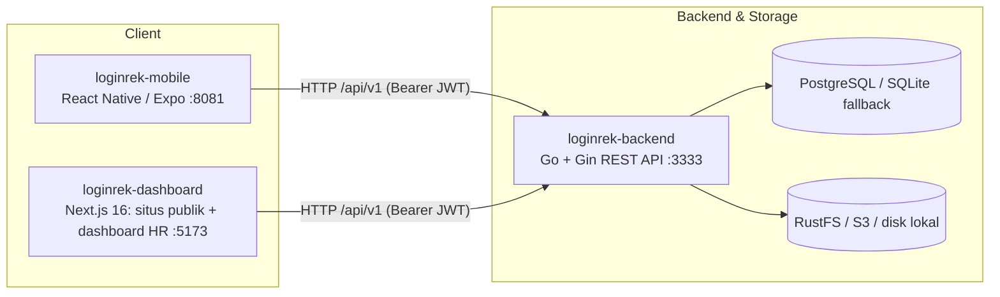
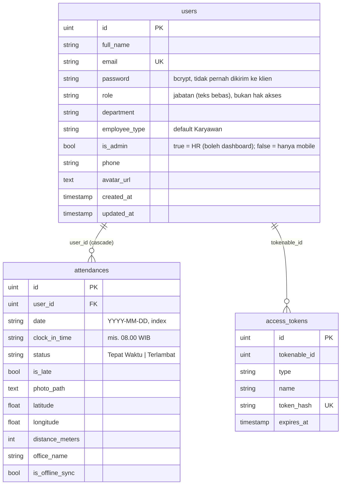

# Arsitektur — SapaKerja

## Gambaran sistem



| Komponen | Peran |
| -------- | ----- |
| `loginrek-backend` | REST API (Gin + GORM). JWT, bcrypt, AutoMigrate, seeder akun uji, kompresi foto ke WebP. PostgreSQL dengan fallback otomatis ke SQLite (`tmp/db.sqlite3`); RustFS/S3 dengan fallback ke `public/uploads/`. |
| `loginrek-dashboard` | Next.js (App Router, Tailwind v4). Situs publik SapaKerja (`/`, `/privacy`; i18n id/en mengikuti bahasa perangkat, SEO/AEO/GEO, Google Tag Manager) dan dashboard HR di `/login`, `/attendance`, `/employees`, `/settings` (monitoring absensi, peta Google Maps tersemat, manajemen karyawan, pengaturan). |
| `loginrek-mobile` | Aplikasi karyawan: login, absen GPS + selfie, riwayat, mode offline-sync. |

Mobile dan dashboard hanya bicara dengan REST API (`docs/API.md`). Tidak ada akses langsung
ke database/bucket.

## Autentikasi

Satu mekanisme untuk semua klien: `POST /auth/login` → JWT (HS256, 30 hari) → `Authorization: Bearer`.
Kata sandi di-hash bcrypt dan hanya diverifikasi server; tidak ada akun/kata sandi di kode klien.

| Klien | Pengguna | Penyimpanan token |
| ----- | -------- | ----------------- |
| Dashboard | HR/admin (`is_admin = true`) | `localStorage` (`admin_token`); diverifikasi `GET /auth/me` saat dibuka |
| Mobile | Karyawan (dan HR) | `expo-secure-store` (Keychain/Keystore) |

**Peran** = satu kolom `users.is_admin` (boolean). `true` = HR, boleh dashboard dan mobile; `false` =
karyawan, hanya mobile (endpoint dashboard membalas 403 dan UI dashboard menolak login). Akun HR pertama
dibuat seeder dari `SEED_ADMIN_EMAIL`/`SEED_ADMIN_PASSWORD` saat tabel `users` masih kosong. Admin
tambahan hanya bisa diangkat (atau dicabut) oleh admin lewat `PUT /employees/:id` (`isAdmin`); `POST
/employees` tidak pernah membuat admin, dan admin tidak bisa mencabut hak admin dirinya sendiri. Kolom `role` hanyalah jabatan (teks bebas) dan tidak mempengaruhi hak akses.
Daftar hak akses per endpoint: `docs/API.md`.

**Offline (mobile)**: login pertama wajib online. JWT disimpan di SecureStore dan dipulihkan saat aplikasi
dibuka, sehingga HP offline tetap bisa absen — absen masuk antrean lokal (`sync-store`) dan dikirim dengan
JWT yang sama saat koneksi kembali (`isOfflineSync: true`). Server membalas 401 → mobile membersihkan sesi
dan meminta login ulang (antrean tidak dibuang).

## Backend

Struktur direktori: lihat [README](../README.md#backend-loginrek-backend).

Konfigurasi lewat environment — lihat `.env.example` di root.

## Skema database

Sumber kebenaran: `loginrek-backend/internal/domain/models.go` (AutoMigrate). Perbarui
bagian ini di PR yang sama dengan perubahan model.



Catatan: belum ada unique constraint `(user_id, date)` — duplikat dicegah di handler.
Tabel `access_tokens` ada di model tetapi autentikasi memakai JWT stateless.

## Mobile

### Lapisan
```
src/app (route)  ->  hook / logic  ->  src/lib/api.ts  ->  REST API
                          ├─ src/lib/session.ts (expo-secure-store)
                          └─ device API: expo-location, expo-camera
```

### Base URL API (`src/lib/api.ts`)

| Situasi | URL |
| ------- | --- |
| `EXPO_PUBLIC_API_URL` di-set (`.env` root / `eas.json`) | nilai tersebut |
| Tidak di-set | `https://api.sapakerja.com/api/v1` (API production) |

Untuk dev lokal, isi `EXPO_PUBLIC_API_URL` dengan alamat API yang terjangkau perangkat: IP laptop (HP fisik satu Wi-Fi),
`10.0.2.2` (emulator Android), atau `localhost` (iOS simulator). Mode `--tunnel` tidak meneruskan port API, jadi pakai URL tunnel API.

### Alur utama
1. Root layout → baca token → `GET /auth/me`; 401 → hapus token → login.
2. Login → `POST /auth/login` → simpan token → Beranda.
3. Beranda → `GET /attendances/today`, tombol Absen.
4. Absen → izin lokasi + kamera → `POST /attendances/check-in`. Bila offline, antrean
   disimpan lalu disinkronkan di latar belakang (`isOfflineSync: true`).
5. Riwayat, Profil.

### Build & rilis (EAS)

| Profil `eas.json` | Untuk |
| ----------------- | ----- |
| `development` | dev client (library native di luar Expo Go) |
| `preview` | uji internal — APK Android |
| `production` | App Store / Play Store (`autoIncrement`) |

```bash
cd loginrek-mobile
npx eas-cli@latest build --profile preview --platform android
```
Rilis iOS butuh Apple Developer Program. Build binary (EAS) dijalankan otomatis oleh CI saat ada perubahan native (lihat "Build native otomatis" di bagian berikut); update JavaScript-nya dirilis otomatis lewat
OTA. <!-- DIUBAH (OTA): kalimat "CI mobile (EAS) belum ada" diganti. -->

### Update OTA (expo-updates, server sendiri)
<!-- DIUBAH (OTA): subbagian baru. Menggantikan server update EAS (u.expo.dev). -->

JS + aset dari JS bisa diperbarui tanpa build baru. Perubahan native tidak bisa lewat OTA: CI **melewati OTA** dan menjalankan build native otomatis (lihat "Build native otomatis").

```
commit di loginrek-mobile/ (bukan .md) ──► job `changes` (mobile=true) ──► job `native-check` (harus `same`)
        └─► job `publish-ota`: env dari eas.json → expo export → manifest + tanda tangan
              → tar → SCP ke VPS → ekstrak ke $DEPLOY_PATH/updates → pindahkan latest.json (terakhir)
HP ──GET /updates/manifest──► Traefik ──► lr-backend (internal/updates, baca /data/updates) ──► manifest + expo-signature
HP ──GET /updates/files/…──► bundle & aset (immutable)
```

- **Pemisahan job** (`.github/workflows/loginrek.yml`): `changes` membandingkan push. `server` (backend, dashboard,
  `docker-compose.prod.yml`, `.env.example`, workflow) → check/build/package/deploy. `mobile` (`loginrek-mobile/**`, kecuali `.md`)
  → `native-check`, lalu `publish-ota` (bila `same`) atau jalur build native (bila `changed`/`missing`). Jalur server dan mobile paralel dan tidak
  saling memicu; antrean per job (`deploy-production`, `ota-production`, `native-build-production`).
  Manual: Run workflow → `target` = `deploy`, `ota`, atau `native`.
- **Tata letak di VPS** (`$DEPLOY_PATH`, default `/opt/loginrek`):

  | Di VPS | Di container backend | Isi |
  | ------ | -------------------- | --- |
  | `updates/` | `/data/updates` (read-only, `UPDATES_DIR`) | `<channel>/<runtime>/latest.json` + `<publishId>/` (`manifest.<platform>.json`, `.sig`, `_expo/…`, `assets/…`) |
  | `ota-state/<channel>/<runtime>.native.txt` | – (tidak di-mount) | acuan sidik jari native untuk pemeriksaan |

  Folder `updates/` harus terbaca container (UID 10001): folder 755, berkas 644 (job menjalankan `chmod -R a+rX`).
  Tersisa 10 rilis terakhir per runtime; sisanya dihapus job. Pointer `latest.json` dipindah paling akhir (atomik).
- **Code signing**: sertifikat publik `loginrek-mobile/certs/certificate.pem` ditanam di app (`app.json` → `updates.codeSigningCertificate`,
  `keyid: main`, `alg: rsa-v1_5-sha256`). Private key **tidak** di repo: lokal di `loginrek-mobile/keys/` (di-ignore) dan GitHub secret
  `UPDATE_SIGNING_KEY` (Environment `production`). Hanya CI yang menandatangani; backend cuma menyajikan `.sig`. Mengganti key/sertifikat = build baru.
- **Pemeriksaan native**: sidik jari = library native produksi di `node_modules`, `app.json` (tanpa `version`/`extra`), isi berkas yang dirujuk
  config (ikon, splash, ikon/suara notifikasi, `google-services.json`, `GoogleService-Info.plist`, sertifikat) dan `patches/`.
  Dibandingkan dengan `ota-state/…native.txt` oleh job `native-check` (skrip inline di workflow): sama → `same` (OTA); beda → `changed`;
  acuan belum ada → `missing`. Pada `changed`/`missing` OTA dilewati (bukan gagal) dan build native yang berjalan.
- **Channel & runtime**: header `expo-channel-name: production` (`app.json`, cocok dengan `eas.json` profil `production`), runtime = `version`
  (`runtimeVersion.policy: appVersion`). Profil `development`/`preview`/`production-internal` punya channel sendiri dan **tidak** menerima OTA ini.
  Nilai `EXPO_PUBLIC_*` diambil dari `eas.json` (`build.production.env`) agar bundle OTA identik dengan build production.
- **Penanda rilis**: setiap rilis punya `publishId` (`<timestamp WIB>-<SHA 7 karakter>`, nama folder di `updates/`). CI menaruhnya di
  `manifest.metadata.publishId` (ikut ditandatangani). Layar Profil mobile menampilkan lingkungan, `v<version> Build (<nomor>)`, dan
  `publishId` (atau "Bawaan build" bila belum ada update OTA) di layar Profil (`profile.tsx`). Rilis sebelum penanda ini ditambahkan
  tidak punya `publishId`; aplikasi menampilkan 8 karakter pertama `updateId` sebagai gantinya.

- **Update saat startup** (`src/lib/startup-update.ts`, dipanggil dari `src/app/_layout.tsx`): dua jalur, dibedakan oleh **penanda first-run**.
  - **Pembukaan pertama di sebuah build native** (install baru, install ulang setelah uninstall, atau update dari store): `runStartupUpdate()`
    memanggil `checkForUpdateAsync` (timeout 6 dtk), bila ada `fetchUpdateAsync` (timeout 15 dtk), lalu `reloadAsync` dan aplikasi restart dengan
    bundle terbaru. Splash native ditahan; bila proses melewati ~500 ms, layar "Menyiapkan pembaruan…" (`UpdateScreen`, di `_layout.tsx`)
    tampil sampai restart. Offline, timeout, atau error apa pun → aplikasi lanjut dengan bundle yang ada (tidak pernah memunculkan error ke UI).
  - **Pembukaan berikutnya di build yang sama**: tidak ada akses jaringan di jalur startup; aplikasi langsung terbuka. Update diunduh di latar
    belakang oleh expo-updates sendiri (`checkAutomatically` dan `fallbackToCacheTimeout` tidak di-override di `app.json`: `ON_LOAD` dan `0`)
    dan dipakai pada pembukaan berikutnya.
  - **Penanda first-run**: kunci `loginrek.startup-update.build` di `expo-sqlite/kv-store`, bernilai `<nativeApplicationVersion>+<nativeBuildVersion>`.
    Bukan SecureStore, karena Keychain iOS bisa bertahan setelah uninstall sehingga install ulang tidak terdeteksi. Penanda disimpan **sebelum**
    `reloadAsync` dan juga di jalur gagal, supaya tidak ada loop restart atau layar loading di setiap buka. Storage yang gagal dibaca dianggap
    bukan first-run. Versi atau nomor build native yang berbeda = first-run lagi. Tidak aktif di `__DEV__` atau saat `Updates.isEnabled` false.
  - **Catatan rilis**: pengguna baru dari store hanya merasakan layar ini di buka pertama bila build store yang mereka pasang **sudah memuat kode ini**;
    build lama tetap memakai perilaku latar belakang saja. Pengujian: `npm test` (`src/lib/__tests__/startup-update.test.ts`).

**Cara rilis** — otomatis saat commit di `loginrek-mobile/` masuk `main`. Pantau di Actions → `loginrek` → `Publish OTA`.

**Build native otomatis** — saat `native-check` = `changed` atau `missing` pada push ke `main` (atau manual: Run workflow → `target=native`):

1. `bump-version`: `missing` (versi di `app.json` belum pernah dibuild) → dipakai apa adanya. `changed` (versi itu sudah pernah dibuild, native berubah)
   → patch dinaikkan (mis. 1.0.3 → 1.0.4) di `app.json` + `package.json`, lalu di-commit CI ke `main` (`chore(mobile): versi X.Y.Z [skip build]`).
   Setelah itu `main` lokal tertinggal satu commit: `git pull` sebelum push berikutnya. Nomor build (`buildNumber`/`versionCode`) diurus counter
   remote EAS (`appVersionSource: remote` + `autoIncrement`).
2. `build-android` (ubuntu) dan `build-ios` (macOS) menjalankan `eas build --local` di runner GitHub: tidak memakai kuota build cloud EAS,
   tetapi memakan menit Actions (macOS lebih mahal pada repo privat).
   **Cadangan per platform**: bila `build-android` (runner Linux) atau `build-ios` (macOS) **gagal**, job `build-android-cloud` / `build-ios-cloud`
   membangun platform itu di EAS cloud (akun Expo pemilik `EXPO_TOKEN`, kredensial dari EAS) dan langsung men-submit build itu dengan `eas submit --id`.
   Berjalan saat build lokal platform tersebut gagal, atau job-nya dibatalkan GitHub (mis. runner macOS tidak didapat: "job was not acquired by Runner of
   type hosted"; timeout) selama run-nya sendiri tidak dibatalkan manual; build yang dilewati tidak memicunya. Memakai kuota build cloud EAS dan bisa mengantre.
   Run tetap berstatus gagal (merah) karena build lokalnya gagal, tetapi ringkasannya mencatat bahwa cadangan dipakai.
3. `submit-android` / `submit-ios`: `eas submit` ke Play track `internal` (draft) dan TestFlight. Keduanya otomatis berjalan bila build lokal platformnya sukses;
   bila yang dipakai build cadangan, submit sudah dilakukan di dalam job `*-cloud`. Release notes, memilih build, dan kirim ke review
   tetap manual di Play Console / App Store Connect.
4. `rebase-native`: setelah Android **dan** iOS sukses (masing-masing lokal, atau lokal gagal lalu cadangan cloud sukses), acuan native versi itu disimpan
   di VPS sehingga OTA untuk versi tersebut otomatis boleh. Bila salah satu platform gagal di kedua jalurnya, acuan tidak ditulis; run ulang memakai
   versi yang sama (tidak naik lagi).

Tambahkan `[skip build]` di pesan commit (commit terakhir pada push) untuk melewati build native. Jangan push commit native bertubi-tubi saat build berjalan.
Prasyarat: secret `EXPO_TOKEN` (Environment `production`); kredensial store tersimpan di EAS (kunci App Store Connect API, service account Google Play);
variabel repo `ASC_APP_ID` (ID numerik app di App Store Connect). Artefak `.aab`/`.ipa` disimpan 7 hari di run Actions untuk submit manual bila perlu.
Build tanpa submit: `target=native` dan matikan `submit`. Pilihan run manual `target=native`: `platform` = `all` (default) / `android` / `ios`, dan
`build_mode` = `auto` (default: lokal, cloud sebagai cadangan) / `local` (lokal saja, tanpa cadangan) / `cloud` (langsung EAS cloud, tanpa build lokal). Run satu
platform saja (`platform` ≠ `all`) tidak menulis acuan native (`rebase-native`): setelah kedua platform terpasang, jalankan `target=ota` + `rebase_native`. Run manual `target=ota` + `rebase_native` tetap ada untuk memasang acuan secara manual
(mis. setelah build dari luar CI).

**Rollback** — rilis update **baru** dari commit yang sehat (revert commit lalu push, atau Run workflow dari commit itu). Jangan hanya
mengembalikan `latest.json` ke ID lama: klien yang sudah mengunduh update baru tidak akan turun ke ID yang lebih lama.

**Secrets** (Environment `production`): `UPDATE_SIGNING_KEY` (isi `keys/private-key.pem`) + `VPS_HOST`, `VPS_SSH_KEY` (wajib),
`VPS_USER`, `VPS_PORT`, `VPS_DEPLOY_PATH` (opsional) yang sudah dipakai deploy. Contoh tanpa mencetak key:
`gh secret set UPDATE_SIGNING_KEY --env production < loginrek-mobile/keys/private-key.pem`.

**Uji di HP**: pasang build `production` yang memuat sertifikat ini, rilis satu update, lalu buka-tutup aplikasi dua kali
(buka pertama mengunduh, buka kedua menjalankan). Di VPS: `curl -i -H 'expo-platform: ios' -H 'expo-runtime-version: 1.0.2'
-H 'expo-channel-name: production' https://api.sapakerja.com/updates/manifest` (204 = belum ada update).

## Deploy

`docker-compose.yml` = infra dev (PostgreSQL + RustFS). `docker-compose.prod.yml` = stack
penuh di VPS, di belakang **Traefik** (jaringan eksternal `traefik-network`, entrypoint
`websecure`, resolver `letsencrypt`), dikirim oleh `.github/workflows/loginrek.yml`.

| Domain | Service | Keterangan |
| ------ | ------- | ---------- |
| `sapakerja.com` | `lr-dashboard` | situs publik (`/`, `/privacy`) dan dashboard HR (`/login`, `/attendance`, ...); server Node Next.js (`output: standalone`, port 3000) |
| `loginrek.bidtech.co.id` (`DASHBOARD_DOMAIN_LEGACY`) | `lr-dashboard` | domain lama dashboard, dilayani langsung (tanpa redirect) |
| `api.sapakerja.com` | `lr-backend` | REST API + foto (`/uploads/*`) + update OTA (`/updates/*`); rate limit 30 req/s per IP (`CF-Connecting-IP`) |
| `loginrek-api.bidtech.co.id` (`API_DOMAIN_LEGACY`) | `lr-backend` | domain lama API; router `lr-api` yang sama, dilayani langsung |

**Dua domain, tanpa redirect.** Router `lr-dashboard` dan `lr-api` memakai `Host(baru) || Host(lama)`; `CORS_ORIGINS` memuat kedua origin dashboard. Domain lama TIDAK di-redirect di Cloudflare: HP dengan build lama masih memanggil `loginrek-api.bidtech.co.id`, dan redirect mengubah POST menjadi GET serta membuang header `Authorization` saat lintas host. Dashboard hanya punya satu `NEXT_PUBLIC_API_URL` (`https://api.sapakerja.com`), termasuk saat dibuka lewat domain lama. Domain lama boleh dipensiunkan setelah tidak ada HP dengan build lama.

<!-- DIUBAH (OTA): `/updates/*` dan volume `./updates` ditambahkan. Saat ini /updates masih memakai router `lr-api` (rate limit + kompresi Traefik yang sama). -->
- `lr-backend` me-mount `./updates` (di samping compose) ke `/data/updates` **read-only**; `UPDATES_DIR=/data/updates`. Lihat "Update OTA".

- PostgreSQL dan RustFS hanya di jaringan `internal` (tidak diekspos ke Traefik). Foto disajikan
  backend lewat `GET /uploads/*key` yang membaca dari RustFS.
- Tidak ada port aplikasi yang dipublikasikan.
  Konsol RustFS hanya lewat SSH tunnel (`127.0.0.1:${RUSTFS_CONSOLE_HOST_PORT}`).
- Nama service berawalan `lr-` karena menjadi alias DNS di `traefik-network` yang dipakai
  bersama project lain.
- Image: `loginrek-backend/Dockerfile` (binary Go statis di alpine, non-root, `/health` untuk healthcheck) dan
  `loginrek-dashboard/Dockerfile` (Next.js `standalone`, non-root, port 3000, healthcheck `/health.json` (berkas statis di `public/`)). Dashboard memakai
  `lr-dashboard` yang sama dengan situs publik; tautan lama `sapakerja.com/dashboard/*` dialihkan (307) ke `/login` dst. Domain lama (`*_LEGACY`) menyajikan
  konten yang sama, tetapi semua halaman memakai canonical `https://sapakerja.com` sehingga tidak dihitung duplikat oleh mesin pencari.
- Variabel `NEXT_PUBLIC_*` dibakar ke bundle saat build lewat build-arg: `NEXT_PUBLIC_API_URL` (wajib; CI: `https://$API_DOMAIN`,
  compose: `https://${API_DOMAIN}`), `NEXT_PUBLIC_SITE_URL` (`https://$DASHBOARD_DOMAIN`), `NEXT_PUBLIC_GTM_ID`, `NEXT_PUBLIC_GA_ID` dan
  `NEXT_PUBLIC_GSC_VERIFICATION` (opsional; dari GitHub repository variables `GTM_ID` (bawaan `GTM-MD232CD5`), `GA_ID`, dan `GSC_VERIFICATION`).
- Production tidak pernah jatuh ke SQLite: bila PostgreSQL tidak terjangkau, backend berhenti dan container
  di-restart. Backend juga menunggu RustFS siap (cek bucket dicoba ulang ±30 detik) sebelum memakai disk lokal.
- Variabel: `.env.example`.
